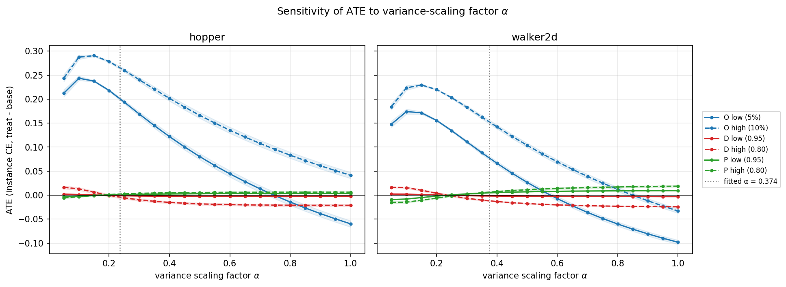

# Counterfactual Causal Attribution of Calibration Failure in Uncertainty-Aware World Models

> **MSc Thesis Research · Artificial Intelligence & Robotics**

This repository contains the research code and experimental design for my Master's thesis on calibration failure in uncertainty-aware world models under mechanism-specific distribution shift.

The project asks a simple question: when the data distribution changes, **which part of the change is responsible for the resulting calibration failure, and how large is that effect?**

The study focuses on three mechanisms of distribution shift:

* **Dynamics shift**
* **Observation shift**
* **Policy shift**

The main goal is to compare these mechanisms under controlled conditions rather than treating distribution shift as a single undifferentiated source of failure.

---

## Why this problem?

Uncertainty estimates are useful only when they provide a reasonably calibrated description of predictive uncertainty.

Under distribution shift, this relationship can break down. A model may remain useful in some respects while its uncertainty estimates become less reliable. More importantly, different types of distribution shift do not necessarily affect the predictive pipeline in the same way.

A change in transition dynamics, for example, is different from corrupting the observation process. A policy change is different again, because it can alter which states and actions are being evaluated.

This thesis studies these mechanisms separately and asks whether their effects on calibration can be distinguished in a controlled experimental setting.

---

## Research Question

> **Which mechanism-specific distribution shift is associated with calibration failure in an uncertainty-aware offline world model, and by how much under controlled intervention?**

The primary comparison is between:

1. **Dynamics intervention**
2. **Observation intervention**
3. **Policy intervention**

The aim is not simply to compare which condition has the largest error. The aim is to examine whether changing the shift mechanism produces a systematic change in calibration-related outcomes under a controlled design.

---

## Study Design

The basic unit of comparison is a matched model-evaluation instance.

The same trained model is evaluated under a baseline condition and under a controlled intervention. Wherever possible, the same evaluation states and reusable sources of randomness are retained across the paired conditions.

This allows the analysis to focus on the difference introduced by the intervention rather than on unrelated variation between runs.

The thesis uses **Common Random Numbers (CRN)** and paired comparisons as part of this design.

The primary estimand is a mechanism-specific average treatment effect relative to baseline. In practical terms, this means measuring how much the chosen calibration outcome changes when one shift mechanism is introduced while the rest of the comparison is kept controlled.

The interpretation remains tied to the experimental design and its assumptions. The project does not claim that a controlled simulation automatically establishes a causal effect in the real world.

---

## Shift Mechanisms

### Dynamics shift

A controlled change is introduced into the transition dynamics during evaluation.

The observation process and action-selection mechanism are kept fixed for the main comparison.

### Observation shift

A controlled transformation is applied to the observations, such as added noise or corruption.

The underlying dynamics and policy are kept fixed.

### Policy shift

The action-selection rule is changed while evaluating the model on a fixed set of probe states.

The main analysis does not use unrestricted rollouts for this intervention. This is intended to avoid mixing the effect of policy change with additional state-distribution drift caused by a new rollout.

The thesis treats these three mechanisms as distinct interventions because they affect different parts of the predictive pipeline.

---

## World Model

The project uses a **state-based probabilistic ensemble world model**.

The baseline design is a small ensemble of multilayer perceptrons trained on offline reinforcement-learning data.

**Model configuration**

* MLP-based probabilistic predictors
* **5 ensemble members**
* Next-state prediction (1-step)
* Gaussian predictive distributions
* Ensemble-based uncertainty estimation

Each ensemble member predicts the next state as a probability distribution conditioned on the current state and action.

In practical terms, the model predicts both a mean and a variance for its next-state estimate. The predictions from the ensemble are then combined to estimate predictive uncertainty and ensemble disagreement.

The ensemble is used as a practical uncertainty-estimation method rather than as the scientific contribution by itself.

---

## Data

The study is designed around **offline reinforcement-learning data** with explicit dataset metadata and manifests.

The current research plan prioritizes benchmark datasets compatible with the Minari / RL4D ecosystem, with **Hopper** and **Walker2d** as the main environments.

Large raw datasets will remain outside Git. The repository will contain dataset manifests, version information, and the metadata needed to reconstruct the experimental setup.

---

## Prediction Horizon

The primary analysis uses **1-step transition prediction**.

This keeps the attribution problem as direct as possible: the intervention is applied to one transition and its effect is measured on the corresponding predictive uncertainty and calibration outcome.

Multi-step rollouts may be studied later as a robustness or propagation analysis, but they are not the primary thesis-level outcome.

---

## Calibration and Evaluation

The main outcome is a **regression-specific calibration error** appropriate for continuous probabilistic prediction.

The evaluation also considers:

* **Negative Log-Likelihood (NLL)**
* **Prediction-interval coverage** (at nominal 50% and 90%)
* **Sharpness**
* **CRPS**
* Predictive uncertainty
* Ensemble disagreement
* Calibration curves
* Error-uncertainty relationships

Calibration and sharpness are treated as complementary properties. A useful uncertainty estimate should not only be statistically aligned with observed outcomes, but should also remain informative rather than unnecessarily broad.

The project therefore does not rely on the classical classification ECE as the primary uncertainty-calibration measure for continuous regression.

---

## Statistical Analysis

The comparison is designed around paired observations and repeated model instances.

The planned analysis includes:

* paired differences (ATE)
* bootstrap confidence intervals
* paired permutation / sign-flip tests
* effect sizes
* multi-seed evaluation
* Holm correction for multiple comparisons

The emphasis is on estimating the size and uncertainty of the mechanism-specific effect, rather than reporting statistical significance alone.

The current design recommends multiple matched training seeds, with the exact number adjusted according to the available compute budget and pilot results.

---
## Key results

We trained 5-member Gaussian MLP ensembles on Minari Hopper and Walker2d
(**10 seeds each**) and evaluated three evaluation-time interventions
(dynamics, observation, policy) at two severities each. The primary
estimand is the paired average treatment effect (ATE) on instance-level
regression calibration error. All numbers are means over **n = 10 seeds**;
confidence intervals use Student's t with `df = 9` (`t_crit = 2.262`).

### 1. Baseline over-dispersion

The 5-member ensemble **over-covers at every nominal level**. Signed
coverage at nominal 0.50 is `+0.35` (empirical 0.85 instead of 0.50).
A single per-seed variance scaling factor fitted on the **calibration
split** (nominal 0.90) brings coverage to nominal:

- Hopper: `alpha = 0.2361` (variance ~4.2x too large)
- Walker2d: `alpha = 0.3743` (variance ~2.7x too large)

### 2. Observation shift dominates after recalibration

Recalibrated ATE (main result), n = 10 per environment:

| Condition | Hopper | Walker2d |
|---|---|---|
| `observation_low`  | **+0.20125** +/- 0.00429 | **+0.07749** +/- 0.00393 |
| `observation_high` | **+0.26588** +/- 0.00319 | **+0.15268** +/- 0.00383 |
| `dynamics_low`     | -0.00113 +/- 0.00068 | -0.00178 +/- 0.00042 |
| `dynamics_high`    | -0.00445 +/- 0.00212 | -0.01194 +/- 0.00125 |
| `policy_low`       | +0.00086 +/- 0.00029 | +0.00486 +/- 0.00071 |
| `policy_high`      | +0.00247 +/- 0.00094 | +0.00630 +/- 0.00248 |

95% t-intervals for all twelve conditions are reported in
[`results/tables/final_n10_summary_recalibrated.csv`](results/tables/final_n10_summary_recalibrated.csv).

Observation effects are **13x to 178x larger** than dynamics or policy
at matched severity labels. All twelve effects exclude zero at 95%.

### 3. Sensitivity to the variance-scaling factor alpha

We swept alpha on a 20-point grid (alpha in [0.05, 1.00]) and recomputed
the ATE for all twelve conditions at each value. The observation effect
remains the dominant pathway across the swept range:

| alpha | Hopper O_high/D_high | Walker2d O_high/D_high |
|---|---|---|
| fitted (0.25 / 0.35) | 45.7x | 15.6x |
| 0.50 | 9.1x | 5.9x |
| 0.75 | 4.6x | 1.1x |
| 1.00 (no recalibration) | 1.9x | 1.4x |

The sign flip in `observation_low` as alpha increases is
**over-dispersion-driven, not environment-driven** -- see
[`docs/paper1_findings.md`](docs/paper1_findings.md).



### 4. Re-simulation bias in dynamics and policy

An identity intervention (`mass_scale=1.0` for dynamics,
`action_scale=1.0` for policy) does **not** reproduce the dataset target
bit-for-bit. The cause is MuJoCo `set_state` + `step` not resetting
`qacc_warmstart` internally, plus the x=0 reconstruction of state from
the observation. Correcting the paired baseline to use
`y_resim(scale=1.0)` changes the D and P ATEs substantially.

### Reproduce
python scripts/final_n10_analysis.py # n=10 corrected ATE
python scripts/final_n10_recalibrated.py # n=10 recalibrated ATE
python scripts/alpha_sensitivity.py --env both # alpha sweep
python scripts/dom_ratio.py # O/D ratio table
python scripts/fill_placeholders.py # sign-flip p-values

See [`docs/paper1_findings.md`](docs/paper1_findings.md) for the full
findings summary and [`docs/paper1_draft/`](docs/paper1_draft/) for the
manuscript draft.

---

## Current Status

> **Status: REPRODUCIBLE**

The research question and experimental protocol are defined and
completed. The full pipeline (Minari data, 10-seed evaluation for both
Hopper and Walker2d, mechanism-specific interventions, CRN-paired
evaluation, baseline recalibration, and alpha-sensitivity sweep) is
implemented and reproducible. Bit-exact reproduction of the original
FROZEN pipeline is verified for baseline and all three interventions.

The project follows an evidence-based maturity model:

`IN DESIGN -> PROTOTYPE -> PRELIMINARY -> VALIDATED -> REPRODUCIBLE`

The current state is **REPRODUCIBLE**. A manuscript draft is available
in `docs/paper1_draft/`, and the key findings are summarized in
`docs/paper1_findings.md`.
---

## Repository Structure

```text
causal-calibration-attribution/
|
|-- README.md
|-- LICENSE
|-- CITATION.cff
|-- requirements.txt
|-- environment.yml
|-- pyproject.toml
|
|-- configs/
|   |-- model/
|   |-- shift/
|   +-- experiment/
|
|-- data/
|   +-- manifests/
|
|-- src/
|   |-- data/
|   |-- model/
|   |-- calibration/
|   |-- interventions/
|   |-- causal/
|   +-- stats/
|
|-- experiments/
|   |-- diagnostics/
|   |-- pilot/
|   |-- phase_A_baseline_calibration/
|   +-- phase_B_mechanism_interventions/
|
|-- results/
|   |-- raw/
|   |-- tables/
|   +-- figures/
|
|-- notebooks/
|
|-- docs/
|   |-- research_questions.md
|   |-- methodology.md
|   |-- counterfactual_design.md
|   |-- causal_assumptions.md
|   |-- limitations.md
|   |-- status.md
|   |-- decision-log.md
|   |-- evidence-map.md
|   |-- negative-results.md
|   |-- provenance.md
|   +-- related_work.md
|
|-- scripts/
+-- tests/
```

The main directories have distinct roles:

* `src/data/` contains dataset loading and episode-level splitting.
* `src/model/` contains the probabilistic world-model implementation.
* `src/calibration/` contains calibration and uncertainty metrics.
* `src/interventions/` contains the dynamics, observation, and policy interventions.
* `src/causal/` contains the counterfactual and causal-analysis layer.
* `src/stats/` contains effect estimation and statistical inference.
* `experiments/` contains experiment definitions and execution scripts.
* `results/` contains figures, tables, and machine-readable outputs.
* `docs/` contains the methodological documentation.
* `tests/` contains implementation and statistical checks.

The causal layer is kept explicit because causal attribution is part of the scientific method of the thesis, not an analysis hidden inside a notebook.

---

## Research Lineage

This repository is the **MSc thesis / diagnosis stage** of a broader research program.

### MSc Thesis

**Counterfactual Causal Attribution of Calibration Failure in Uncertainty-Aware World Models under Mechanism-Specific Distribution Shift**

The thesis focuses on identifying and quantifying mechanism-specific calibration failure under controlled interventions.

### Paper 1

**Why Ensembles Miscalibrate Differently: Causal Attribution of Calibration Failure under Dynamics, Observation, and Policy Shift**

The planned paper extends the empirical diagnosis and studies mechanism differences in greater detail.

### Broader Research Direction

**Reliable Decision-Making for AI Systems under Uncertainty and Distribution Shift: A Causal Approach to Calibration and Safety**

The longer-term research direction moves from diagnosis toward causally informed recalibration and safer downstream decision-making.

---

## Author

**Morteza Toghani**

MSc Artificial Intelligence & Robotics
